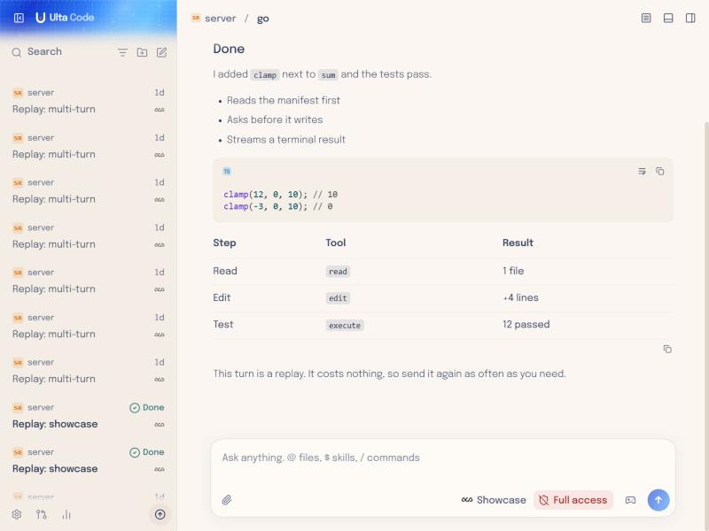
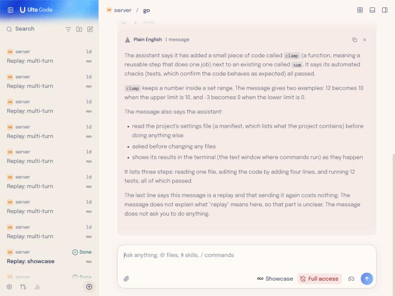
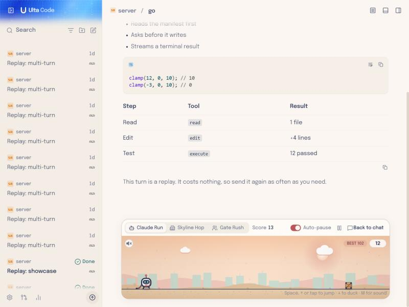
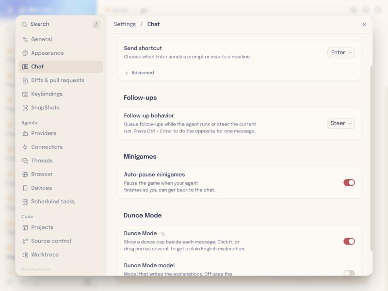
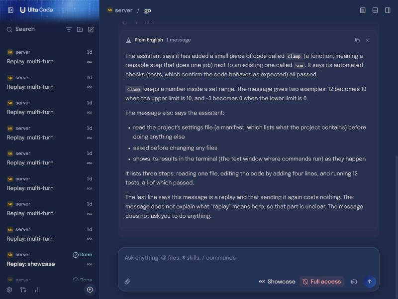

<p align="center">
  
</p>

<h1 align="center">Ulta Code</h1>

<p align="center">
  A calm desktop app for coding agents, for people who are still learning to code.<br />
  Works with your Claude Code, Codex, Cursor, Grok Build, OpenCode, Antigravity and fx subscriptions.
</p>

---

> This is a fork of [T3 Code](https://github.com/pingdotgg/t3code). I love what they're doing with it, and am following with interest - you'll probably see their updates pushing across to Ulta Code too.
>
> The reason for making my own version is this. I'm technically minded, but I can't code and I can't profess to be a programmer. I'm just a vibe coder, but I am trying to learn how to code. I love Claude Codes app, but I think it dumbs down coding too much. Cursor is too complex. T3 Code is halfway between, but it's just not quite right for me.
>
> My simplest but favourite add-on is the 'Dunce Mode' you can enable in settings. You can select the dunces hat next to one or more messages that you don't understand, and it'll explain in non-technical English, what it has just said or done.
>
> My next favourite is a set of minigames I can play while it's coding away. They autopause when the agent is finished or has a question.
>
> — **calm032019**



## Dunce Mode

Turn it on in **Settings → Chat → Dunce Mode**. A small dunce cap appears beside every message. Click it, or
drag across several caps, and Ulta Code rewrites what the agent said or did in plain, non-technical
English. Jargon gets a short explanation in brackets, and it tells you when the agent is waiting on you.

Explanations stay on your device and are never sent back to the agent. They use the thread's own
provider with its small, fast model, or a model you pick under **Dunce Mode model**.



## Minigames while you wait

Press the controller button in the composer to swap it for a game while the agent works:

- **Claude Run**: an endless runner at sunset
- **Skyline Hop**: a rooftop platformer through a dusk city
- **Gate Rush**: pick the multiplier gates and grow your crowd

With **Auto-pause** on, the game pauses as soon as the agent finishes or asks you a question, and
**Back to chat** puts the composer back.



## Everything else that's different

- **A calmer look**: a warm cream (light) and deep navy (dark) palette with coral accents, and Epilogue
  Light for conversation text. Your own themes in **Settings → Appearance** still win.
- **Plain permissions and honest status**: clearer permission choices, and reconnect states that say what
  is really happening.
- **Session timeline and activity**: a vertical timeline with a "you are here" marker, and one panel showing
  everything that happened in the thread.
- **Problems with "Fix with agent"**: errors from scripts you run show up in thread details, ready to hand
  to the agent.
- **Ask the agent to edit selected lines** straight from the file preview, and **find code by meaning** from
  the command palette.
- **Connectors page** listing the MCP servers each provider has set up.
- **Usage plan** that spreads your daily usage against weekly and monthly limits.
- **Continue a thread on another machine**, and **API keys for Claude** instances.
- **Dates in your own region's format.**

<details>
<summary>Settings and dark mode</summary>





</details>

## Getting started

There are no downloadable builds of Ulta Code yet, so for now you build it yourself.

**1. Sign in to at least one agent** on your computer:

- Claude: install [Claude Code](https://claude.com/product/claude-code) and run `claude auth login`
- Codex: install [Codex CLI](https://developers.openai.com/codex/cli) and run `codex login`
- Cursor: install [Cursor CLI](https://cursor.com/cli) and run `agent login`
- Grok Build: install [Grok Build CLI](https://x.ai/cli) and run `grok login`
- OpenCode: install [OpenCode](https://opencode.ai) and run `opencode auth login`
- Antigravity: enable it in Settings, then use **Install Antigravity** and **Sign in with Google**
- fx: install [fx](https://fx.sh) and run `fx login` ([setup guide](./docs/user/providers-fx.md))

**2. Install [Vite+](https://viteplus.dev/guide/)**, which gives you the `vp` command:

```bash
curl -fsSL https://vite.plus | bash
```

On Windows, in PowerShell:

```powershell
irm https://vite.plus/ps1 | iex
```

**3. Get the code and install its dependencies:**

```bash
git clone https://github.com/calm032019/Ulta_Code.git
cd Ulta_Code
vp i
```

**4. Run it.** `vp run dev` starts the app in your browser, and `vp run dev:desktop` opens the desktop app.
To build an installer, run `vp run dist:desktop:win`, `vp run dist:desktop:dmg` or
`vp run dist:desktop:linux`.

## Staying in sync with T3 Code

Ulta Code takes in each stable T3 Code release, and never touches its own changes or branding along the way.
[FORK.md](./FORK.md) lists everything that's been changed and the rules every sync follows. Run
`vp run upstream:check` to see what the next release would bring in before anything is merged.

## Documentation

Most of T3 Code's guides apply to Ulta Code as well:

- [Install and first run](./docs/user/install.md) · [FAQ](./docs/user/faq.md)
- [The composer, including Dunce Mode](./docs/user/composer.md)
- [Permission modes](./docs/user/permission-modes.md) · [Keyboard shortcuts](./docs/user/keybindings.md)
- [Appearance](./docs/user/appearance.md) · [Project settings](./docs/user/project-settings.md)
- [Remote access from a phone or another machine](./docs/user/remote-access.md)
- [Source control integrations](./docs/user/source-control.md)
- Multiple accounts: [Codex](./docs/user/providers-codex.md) · [Claude](./docs/user/providers-claude.md)

Building on the code? Start at [docs/internals/overview.md](./docs/internals/overview.md).

## Credits

Ulta Code is built on [T3 Code](https://github.com/pingdotgg/t3code) by T3 Tools Inc., and keeps its
[MIT license](./LICENSE). All the credit for the foundation goes to them.
